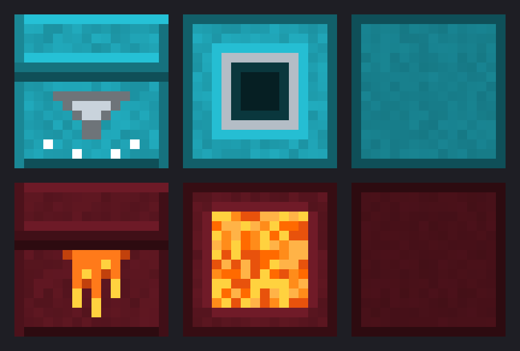

# ShulkerVaccuum

A plugin for Minecraft **1.17 to 26.3** (Spigot, Paper and Purpur) that adds two special shulker boxes.

| Box | Recipe (shapeless) | In your **off-hand** | In your **main hand** |
| --- | --- | --- | --- |
| **Shulker Box of Vacuum** | any shulker box + hopper | Blocks you mine go straight into the box | Items you pick up go into the box |
| **Shulker Box of Trash** | any shulker box + lava bucket | Blocks you mine are deleted | Items you pick up are deleted |

- Any colour of shulker box works, and the crafted box **keeps its colour and contents**.
- A full Vacuum box hands the rest to your normal inventory, so nothing is lost.
- Shulker boxes are never stored or deleted, and breaking a chest, barrel or other container is left alone, so a box in your hand can't swallow or destroy a container's contents.
- You can convert a Vacuum box into a Trash box (or back) by crafting it again with the other item.
- Boxes made with version 1 of the plugin still work.

## Download

Get the latest `ShulkerVaccuum-*.jar` (and the optional texture pack) from [Releases](https://github.com/cashroy/ShulkerVaccuum/releases). Drop the jar into your server's `plugins` folder and restart.

## Textures

On Minecraft **1.21.4 and newer**, the boxes have their own look in your inventory and hands (a placed box still shows as a normal shulker box of its colour). Older versions show the normal shulker box look.



The textures come from a small resource pack, `ShulkerVaccuum-pack.zip`, in this repo. To have the server send it to everyone, add these lines to `server.properties` and restart:

```properties
resource-pack=https://raw.githubusercontent.com/cashroy/ShulkerVaccuum/main/ShulkerVaccuum-pack.zip
resource-pack-sha1=1e2161df1b22b0e35fab1bb83629c1eeb8d25b9a
require-resource-pack=false
```

Players accept the pack when they join. (Or drop the zip into your own `.minecraft/resourcepacks` folder instead.) Boxes crafted before the textures were added switch to the new look when you join or use them.

If you change anything in `resourcepack/`, rebuild the zip with `python3 tools/build-pack.py`, then update `resource-pack-sha1` to the hash it prints.

## Requirements

- Spigot, Paper or Purpur, Minecraft **1.17 to 26.3**
- Java 16 or newer (whatever your server version already needs)

## Building

```bash
mvn package
```

This builds `target/ShulkerVaccuum-<version>.jar` against the oldest supported API (Spigot 1.17.1) so it runs on every supported version. To check it also compiles against the newest Paper API:

```bash
mvn compile -Djava.version=25 -Dapi.groupId=io.papermc.paper -Dapi.artifactId=paper-api -Dapi.version=26.3.build.142-beta
```

GitHub Actions runs both on every push.

## Releasing a new version

Bump `<version>` in `pom.xml`, update `.github/release-notes.md`, and push to `main`. To support a newer Minecraft version, raise `MC_MAX` in `.github/workflows/build.yml` (and the Paper API version in the compat job) once you've tested it. GitHub Actions builds the jar and publishes the release (and the Modrinth version, once `MODRINTH_TOKEN` and `MODRINTH_PROJECT_ID` are set in the repo's Actions settings).

## License

MIT, see [LICENSE](LICENSE).
