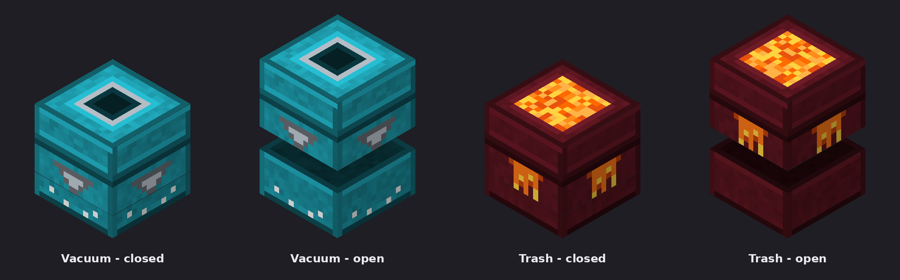

# ShulkerVaccuum

A plugin for Minecraft **1.17 to 26.3** (Spigot, Paper and Purpur) that adds two special shulker boxes.

| Box | Recipe (shapeless) | In your **off-hand** | In your **main hand** |
| --- | --- | --- | --- |
| **Shulker Box of Vacuum** | any shulker box + hopper | Blocks you mine go straight into the box | Items you pick up go into the box |
| **Shulker Box of Trash** | any shulker box + lava bucket | Blocks you mine are deleted | Items you pick up are deleted |

- Any colour of shulker box works, and the crafted box **keeps its colour and contents**.
- A full Vacuum box hands the rest to your normal inventory, so nothing is lost.
- Shulker boxes are never stored or deleted, and breaking a chest, barrel or other container is left alone, so a box in your hand can't swallow or destroy a container's contents.
- You can convert a Vacuum box into a Trash box (or back) by crafting it again with the other item.
- Boxes made with version 1 of the plugin still work.

## Download

Get the latest `ShulkerVaccuum-*.jar` from [Releases](https://github.com/cashroy/ShulkerVaccuum/releases). Drop the jar into your server's `plugins` folder and restart.

## Textures and placed boxes

On Minecraft **1.21.4 and newer** the boxes get their own look, in your inventory and hands and when placed. Opening a placed box lifts and twists its custom lid, just like a shulker box:




How it works: a placed Vacuum or Trash box is still a real shulker box underneath, so storage, hoppers, mining, pistons and explosions all behave normally. The plugin covers it with a custom 3D model (two display entities, the base and the lid) and animates the lid when someone opens it. Older Minecraft versions show the normal shulker box look; everything else still works.

**The texture pack is sent automatically.** The plugin adds its pack for each player as they join, alongside any other server pack (for example The Sift's), so there's nothing to set in `server.properties`. Players are asked to accept it. If you'd rather make it compulsory, or turn off the placed-box look, see `plugins/ShulkerVaccuum/config.yml`:

```yaml
placed-skins: true          # custom look on placed boxes (players without the pack would see a missing-texture cube)
resource-pack:
  send: true                # send the pack to players (1.21.4+)
  required: false           # true = players must accept it
```

Prefer `server.properties` instead? Set `resource-pack.send: false` and use:

```properties
resource-pack=https://raw.githubusercontent.com/cashroy/ShulkerVaccuum/main/ShulkerVaccuum-pack.zip
resource-pack-sha1=9321f0c028efabd28a1e38b3a70ded81501d99e9
```

If you change anything in `resourcepack/`, run `python3 tools/build-pack.py`. It rebuilds the zip and updates the hash in `pom.xml` and this README.

**Works with The Sift and other custom-block plugins.** The Sift draws its blocks over note blocks; ShulkerVaccuum uses display entities over real shulker boxes, so they don't clash.

## Requirements

- Spigot, Paper or Purpur, Minecraft **1.17 to 26.3**
- Java 16 or newer (whatever your server version already needs)

## Building

```bash
mvn package
```

The jar ends up at `plugin/target/ShulkerVaccuum-<version>.jar`. The project has three parts:

- `common`: the plugin itself, built against the **oldest** API (Spigot 1.17.1, Java 16) so the jar loads on every supported version.
- `skins`: the placed-box look and pack sending, built against Spigot 1.21.4. It's only loaded on servers that support it.
- `plugin`: packs both into one jar, with `plugin.yml` and `config.yml`.

To check everything also compiles against the newest Paper API:

```bash
mvn compile -Dcommon.java=25 -Dcommon.api.groupId=io.papermc.paper -Dcommon.api.artifactId=paper-api -Dcommon.api.version=26.3.build.142-beta \
            -Dskins.java=25 -Dskins.api.groupId=io.papermc.paper -Dskins.api.artifactId=paper-api -Dskins.api.version=26.3.build.142-beta
```

GitHub Actions runs both on every push.

## Releasing a new version

Bump `<version>` in the four `pom.xml` files (root, `common`, `skins`, `plugin`), update `.github/release-notes.md`, and push to `main`. To support a newer Minecraft version, raise `MC_MAX` in `.github/workflows/build.yml` (and the Paper API version in the compat job) once you've tested it. GitHub Actions builds the jar and publishes the release (and the Modrinth version, once `MODRINTH_TOKEN` and `MODRINTH_PROJECT_ID` are set in the repo's Actions settings).

## License

MIT, see [LICENSE](LICENSE).
